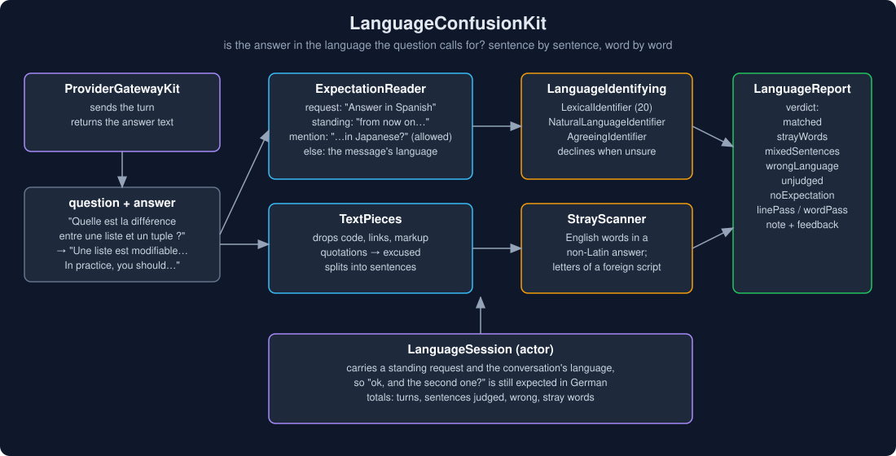
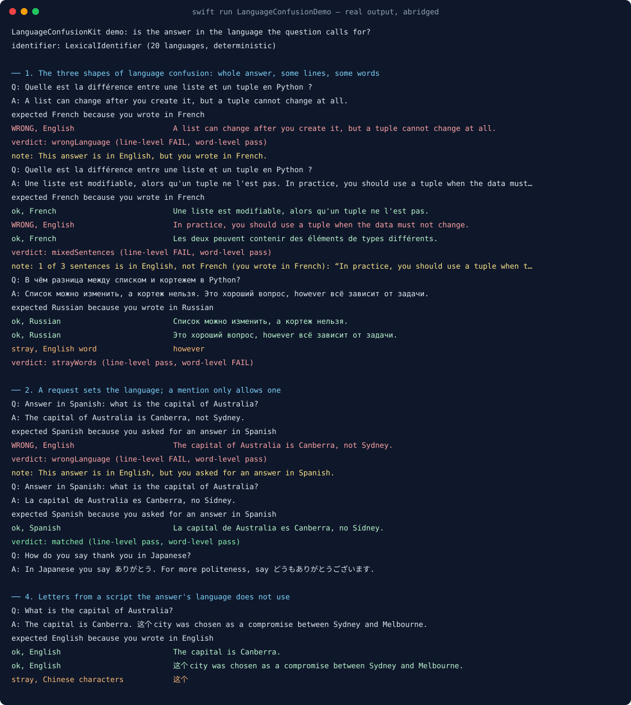
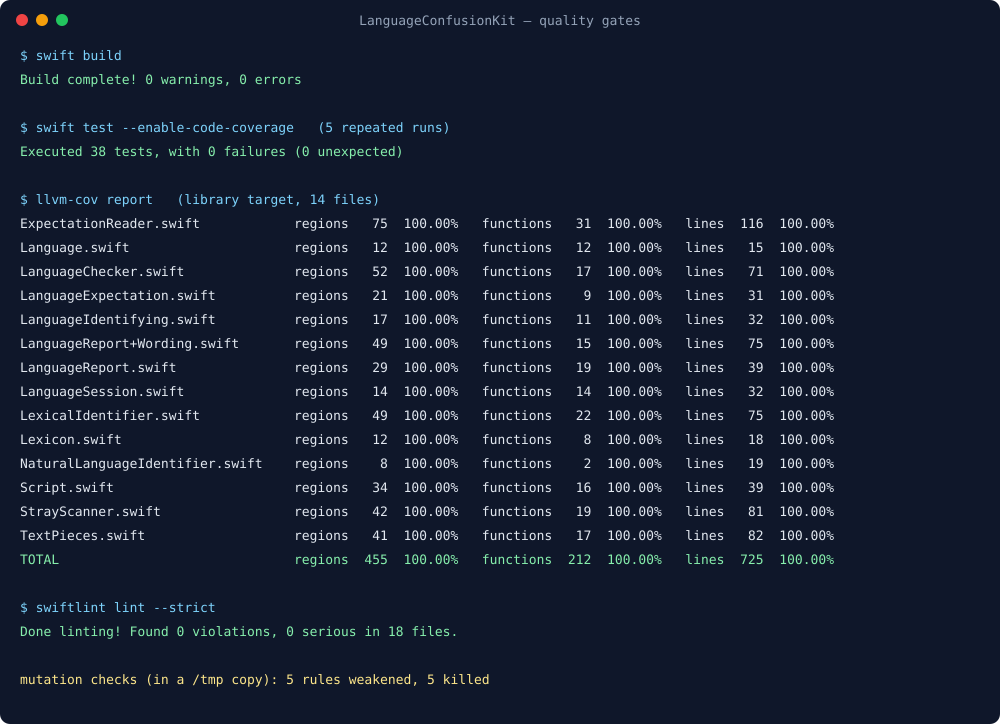

# LanguageConfusionKit



A user asks, in French, what separates a list from a tuple in Python. The answer starts in French,
switches to English for the sentence that matters ("In practice, you should use a tuple when the data
must not change"), and switches back. Another user writes in Japanese and gets a fluent Japanese answer
with "however" and "because" dropped into it. A third asks a plain English question and gets an English
answer with 这个 in the middle of a sentence. A fourth writes "Answer in Spanish" and gets English.

Marchisio et al. call this **language confusion** (*Understanding and Mitigating Language Confusion in
LLMs*, EMNLP 2024, arXiv 2406.20052) and measure it at two levels: whole lines in the wrong language,
and single words. Their benchmark found it severe in widely used open models, worse with English-only
instruction tuning, complex prompts and high temperatures. A chat client that routes the same
conversation to many models meets all of them.

LanguageConfusionKit reads what language an answer should be in, then checks the answer sentence by
sentence and word by word, and says which sentences and words are off, why it expected what it
expected, and how to ask for a rewrite.

## Why

Nothing else in this ecosystem looks at the language of an answer. `InstructionComplianceKit` checks
length, lists, words and formats a user asked for; `StructuredOutputKit` checks a developer's schema.
"Answer in Spanish" is an instruction too, and "the user wrote in French" is one nobody writes down.

The hard part is not identifying a language. It is not crying wolf: an answer in Spanish that quotes an
English error message, shows Python code with English comments, names Guido van Rossum, or repeats the
user's own English phrase is not confused. A checker that flags those is a checker people turn off.

## What it gives you

- **`LanguageChecker`** — `check(answer:question:standing:conversation:)` returns a `LanguageReport`.
- **`ExpectationReader`** (through `checker.read(question:)`) — the language the answer should be in and
  where that came from: a request this turn (`.requested`), a standing one from an earlier turn
  (`.standing`), the language of the message itself (`.userMessage`), or of the conversation when the
  message is too short to tell, like "ok" (`.conversation`). Languages the message *mentions* or asks
  to translate into are allowed alongside.
- **`LanguageIdentifying`** — one method, `identify(_:) -> LanguageGuess`, that may decline:
  - `LexicalIdentifier`: deterministic, no model, runs anywhere Swift does. Twenty languages: English,
    French, German, Spanish, Italian, Portuguese, Dutch, Turkish, Indonesian, Vietnamese, Russian,
    Ukrainian, Greek, Hebrew, Arabic, Hindi, Thai, Chinese, Japanese, Korean.
  - `NaturalLanguageIdentifier`: Apple's `NLLanguageRecognizer`, about sixty languages (Apple platforms).
  - `AgreeingIdentifier(a, b, ...)`: a language only when every identifier names the same one.
- **`LanguageReport`** — a verdict (`noExpectation`, `unjudged`, `matched`, `strayWords`,
  `mixedSentences`, `wrongLanguage`), every sentence with its status (`expected`, `allowed`, `wrong`,
  `excused`, `unjudged`), the stray words, the benchmark's `linePass` and `wordPass`, a `note` for the
  user, a `feedback` re-prompt for the model, and a one-line `summary` for a trace.
- **`LanguageExpectation.instruction`** — "Answer in French. Keep code, names and quotations as they
  are." for a system message, so you can ask before the model answers as well as check after.
- **`LanguageSession`** (actor) — carries a standing request and the conversation's language across
  turns, with running totals.

## Usage

```swift
import LanguageConfusionKit

let checker = LanguageChecker()
let report = checker.check(
    answer: "Une liste est modifiable, alors qu'un tuple ne l'est pas. "
        + "In practice, you should use a tuple when the data must not change.",
    question: "Quelle est la différence entre une liste et un tuple en Python ?"
)
report.verdict      // .mixedSentences
report.note         // "1 of 2 sentences is in English, not French (you wrote in French): “In practice, …”."
report.feedback     // "Rewrite the whole answer in French, because the user wrote in French. ..."

// Across a conversation:
let session = LanguageSession()
await session.review(answer: "Ein Tupel ist eine Folge von Werten, ...",
                     question: "From now on, reply in German. What is a tuple?")
let next = await session.review(answer: "A list is like a tuple, but ...", question: "ok, and a list?")
next.note           // "This answer is in English, but you asked earlier for answers in German."

// Before the call, for the system message:
let hint = await session.expectation(for: "Danke! Und ein Dictionary?")?.instruction
```

With a model's own language identification on Apple platforms, and fewer findings judged wrongly:

```swift
let checker = LanguageChecker(identifier: AgreeingIdentifier(NaturalLanguageIdentifier(), LexicalIdentifier()))
```

### Rules that decide a result

| Situation | Result |
|---|---|
| "Answer in Spanish", "In French, please", "Russian only", "switch to Italian", "auf Deutsch", "日本語で" | a request: the answer must be in that language |
| "Can you answer in Portuguese?" | a request (a yes-no question with a response verb) |
| "What is 'cat' in French?", "Do you speak French?", "And what is dog in French?" | a mention: French sentences are allowed, not required |
| "How do you say thank you in Japanese?", "Translate … into German" | a translation target: allowed |
| "From now on, reply in German" | standing until another request or "any language" |
| no request | the language the message is written in (quotations and code left out) |
| "ok", "thanks!" | the conversation's last identified language |
| fenced or inline code, links, e-mail addresses, markdown markup | removed before anything is read |
| `> block quotes` and “quoted phrases” | excused: never a finding |
| a sentence that repeats the user's message | excused |
| a sentence the identifier will not commit on (names, headings, fragments) | unjudged: never a finding |
| a judged sentence in a language neither expected nor allowed | wrong (line-level confusion) |
| every judged sentence wrong, and more than half of the read letters | `wrongLanguage`; otherwise `mixedSentences` |
| a common English word in an answer whose language uses another script | stray (word-level confusion), unless the user wrote it, or it is an acronym, CamelCase or code |
| letters of a script neither the expected language nor an allowed one uses (这个 in English, カタカナ in Chinese) | stray, unless the user wrote them |
| Han with hiragana, or mostly katakana | Japanese; other Han is Chinese, so one katakana loanword in Chinese stays Chinese |
| Latin or Cyrillic text | scored on telling words and letters; the best language needs 1.25 and 1.5 times the runner-up, or it is undetermined |

## Where it sits

- **ProviderGatewayKit** sends the turn; this package checks the answer that comes back, and
  `instruction` can go into the system message before the turn is sent.
- **OutputRepairKit** runs a bounded repair loop; `report.feedback` is the re-prompt.
- **InstructionComplianceKit** checks the other instructions a user gives; this one checks the language
  instruction, written or not. Run both.
- **ai-chat-app** runs it as the `languageMatch` stage after the model answers.

## Demo

`swift run LanguageConfusionDemo` runs seven scenarios on fixed text, no network. Real output, abridged
(the whole run is in [`Screenshots/demo-output.txt`](Screenshots/demo-output.txt)):

```
── 1. The three shapes of language confusion: whole answer, some lines, some words
   Q: Quelle est la différence entre une liste et un tuple en Python ?
   A: Une liste est modifiable, alors qu'un tuple ne l'est pas. In practice, you should use a tuple when the data must not change. Les deux peuvent contenir des éléments de types différents.
   expected French because you wrote in French
   ok, French                          Une liste est modifiable, alors qu'un tuple ne l'est pas.
   WRONG, English                      In practice, you should use a tuple when the data must not change.
   ok, French                          Les deux peuvent contenir des éléments de types différents.
   verdict: mixedSentences (line-level FAIL, word-level pass)
   Q: Pythonのリストとタプルの違いは何ですか？
   A: リストは変更可能ですが、タプルは変更できません。because タプルはハッシュ可能なので、辞書のキーに使えます。
   stray, English word                 because
   verdict: strayWords (line-level pass, word-level FAIL)

── 3. What is never a finding: code, quotations, names, the user's own words, fragments
   expected Spanish because you wrote in Spanish
   ok, Spanish                         La función falla porque el índice empieza en cero y no en uno.
   excused, a block quotation          IndexError: list index out of range
   ok, Spanish                         El mensaje dice , es decir, el índice no existe.
   excused, a quotation                list index out of range
   unjudged, no telling words          Guido van Rossum, PEP 8
   verdict: matched (line-level pass, word-level pass)
```



## Install

```swift
.package(url: "https://github.com/rajatslakhina/language-confusion-kit.git", from: "1.0.0")
```

Swift tools 6.0, Swift 6 language mode. macOS 13, iOS 16, tvOS 16, watchOS 9. No dependencies;
`NaturalLanguageIdentifier` is compiled only where `NaturalLanguage` exists.

## Quality gates

All run on this machine (Swift 6.4, SwiftLint 0.63.2), and again on a fresh clone of this repository
after it was pushed:

- `swift build`: 0 warnings, 0 errors.
- `swift test --enable-code-coverage`: 38 tests, 0 failures, green on 5 repeated runs.
- `llvm-cov report`: **100.00%** regions (455), functions (212) and lines (725) on all 14 library files
  ([`Screenshots/coverage.txt`](Screenshots/coverage.txt)).
- `swiftlint lint --strict`: 0 violations in 18 files, no suppressions.
- Five rules were mutation-checked in a copy: reading any kana as Japanese fails 2 assertions; dropping
  the lead-in words before a question word ("And what is dog in French?") fails 1; not excusing a
  sentence that repeats the user's message fails 1; calling an answer `wrongLanguage` when its one wrong
  sentence is a small part of it fails 1; flagging English words the user wrote themselves fails 2.

The tests found two gaps before the demo ran: "And what is dog in French?" was read as a request
(the leading "and" hid the question word), and a Chinese sentence with one katakana word was read as
Japanese (the rule now looks for hiragana). The demo then found three more, each fixed and pinned by a
test: a short Spanish answer ("La capital de Australia es Canberra, no Sídney.") was left unjudged, so
the bar for a Latin-script language came down from 1.5 to 1.25 with the margin unchanged; a Russian
sentence built on "а" and "нельзя" had no telling words; and removing a quotation left a double space
in the sentence shown to the user.



## Limits, stated plainly

- **Twenty languages, lexically.** `LexicalIdentifier` declines everything else, and the checker then
  judges nothing; use `NaturalLanguageIdentifier` (alone, or agreeing with the lexical one) for more.
  Arabic script is read as Arabic (not Persian or Urdu), Devanagari as Hindi, Cyrillic as Russian or
  Ukrainian only.
- **Close languages need telling words.** Spanish, Portuguese and Italian, or Dutch and German, are told
  apart by function words; a short sentence without them is left unjudged, by design.
- **Requests are read in English, plus a few native phrasings.** "Réponds en anglais" is read as a French
  message, not as a request for English.
- **Only English is looked for among stray Latin words**, as the benchmark does. A French word in a
  Japanese answer is taken to be a name.
- **Sentences, not lines.** A line is split into sentences, so one English sentence inside a long French
  paragraph is found; a mid-sentence switch of a few words is word-level, and in a Latin-script answer
  only another script's letters are caught there.
- **The tests are home-made.** 38 tests written alongside the code show the rules do what they say, not
  how often real answers fall outside them. The benchmark's own data (github.com/for-ai/language-confusion)
  would be the next check.

## License

MIT. See [LICENSE](LICENSE).
